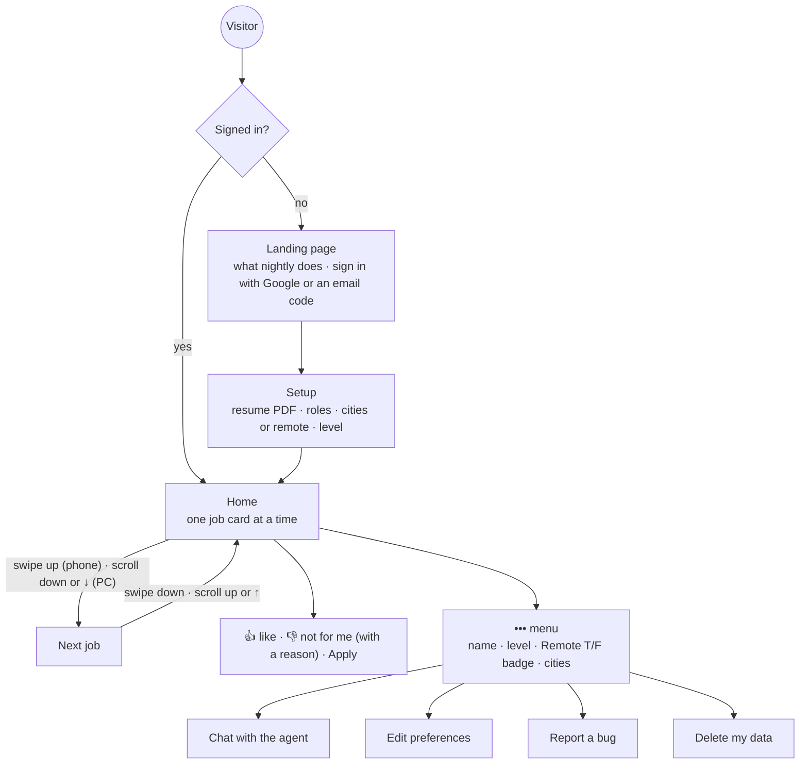
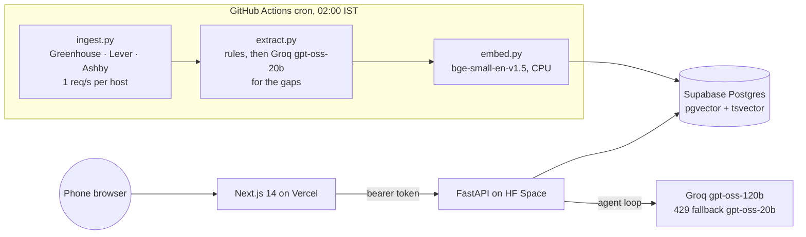

# nightly

Wake up to a short list of startup jobs you can actually apply for.

nightly is a mobile-first job-matching web app for Indian students and freshers. Every night it reads the public job boards of startups that hire in India. It pulls structured fields out of each posting and indexes them. You then get matches for your resume, with a reason for each match that is built from data. You can also chat with an agent that searches for you.

- **App:** https://nightlyjobs.vercel.app
- **API:** https://suharshit-nightly-api.hf.space (`/health`)
- **Demo video:** _to be added Sunday_

The product aims for fewer, better jobs. A job's level is shown only when the posting states it. Otherwise the card says "Level not stated" rather than guessing.

## What it does

- **Sign in with Google and upload a resume** (PDF, at most 5 MB). Skills and a resume vector are taken from it.
- **Matches.** A feed built from your resume, or a typed search. The level filter offers student, fresher and junior, so a fresher never sees jobs that state a senior level. Each card gives a reason built only from fields we hold, for example "Matches your Python + SQL · Remote · Fresher-friendly · Posted 2 days ago".
- **Feedback.** 👍, or 👎 with a reason ("too senior", "wrong location", ...). A 👍 moves your taste vector. A 👎 reason becomes an avoid rule.
- **Apply and Share on WhatsApp** on every card.
- **New since yesterday:** jobs added by the latest nightly run.
- **Chat.** An agent with 5 tools: `search_jobs`, `get_job`, `update_prefs`, `record_feedback` and `explain_match`. It can only name jobs that a tool returned this turn, and the server checks this.
- **Report a bug** from inside the app; reports are listed for the owner on `/stats`.
- **Delete my data** (in the ••• menu) removes your account and every row tied to it.

<!-- user-flow:start -->
## User flow



Every screen uses the same frame: the logo, the theme switch and (once signed in) the ••• menu on top, with the content below in square-cornered boxes.

- **Home.** Shows one job card at a time. The card holds the title, company, place, post date, level, experience, work mode, city, skills, why it matched, and a WhatsApp share link. The bar under it has 👍, 👎 and Apply.
- **Landing page.** Signed-out visitors get the same frame, with what nightly does and the sign-in box.
- **Report a bug.** Anyone, signed in or not, can report a bug from the app, without a GitHub account. The owner sees the reports on `/stats`.
<!-- user-flow:end --><!-- user-flow:end -->

## Architecture



### Search, one request

1. **Hard filter in SQL.** Active canonical jobs only, plus the level, city and remote filters. Level: a job passes when its stated seniority and years fit; jobs that state no level pass with the "Level not stated" label.
2. **Keyword search.** Postgres full-text search, top 50. The query terms are joined with OR, and common alternate spellings are added (golang↔go, ml↔"machine learning", sde↔"software engineer").
3. **Vector search.** pgvector cosine distance on bge-small embeddings, top 50.
4. **Fusion.** Reciprocal rank fusion (k = 60) down to the top 30. Everything up to here runs in one SQL round trip.
5. **Rerank.** `cross-encoder/ms-marco-MiniLM-L-6-v2` on CPU.
6. **Personalise** (signed in): `1.0·rerank + 0.3·taste + 0.2·skill Jaccard − 0.5·dislike penalty`.
   - The resume feed also adds `0.1·freshness` and allows at most 2 jobs per company in any 5.
   - Typed searches skip both, because the eval showed they cost NDCG.
7. **Reasons.** Each card's reason is built only from stored fields.

### Extraction

- **Rules first.** Deterministic rules run on every job: skills, seniority from the title, years of experience, salary in INR, work mode and city. They are free.
- **LLM for the gaps.** Where the rules miss a field that search relies on, Groq `openai/gpt-oss-20b` fills it, with a strict JSON schema.
- **Evidence check.** An LLM's years are kept only if the posting states that number. Seniority never comes from the LLM: it comes from the title or from the kept years. Unknown is safer than wrong.

### Agent

- **Loop.** A plain tool-calling loop over Groq's OpenAI-compatible API, with no framework (`api/app/agent/loop.py`).
- **Reply format.** The final answer must validate as `AgentReply` (Pydantic). If it doesn't, the agent is asked again once; after that the server sends a plain fallback reply.
- **Memory.** The last 10 messages, plus saved preferences in `profiles.prefs`.
- **Rate limits.** Groq's limits are read from the `x-ratelimit-*` headers. A signed-in user gets 10 chat messages per 24 hours.

## Stack

| Part | Choice |
|---|---|
| Web | Next.js 14 + Tailwind, Vercel (free) |
| API | FastAPI + Pydantic v2, Hugging Face Space (free) |
| Database | Supabase Postgres with pgvector and tsvector (free tier), row-level security on every table |
| Jobs | GitHub Actions cron: ingest → rules extract → Groq extract → embed |
| Models | Open weights only. Groq free tier (`gpt-oss-120b` agent, `gpt-oss-20b` extraction and fallback), `BAAI/bge-small-en-v1.5`, `cross-encoder/ms-marco-MiniLM-L-6-v2` |
| Data | Public Greenhouse, Lever and Ashby job-board APIs only; no scraping |

Budget: ₹0.

## Data

- **Last nightly run (28 Nov 2026):** 120 company boards, 0 failed, 2,068 active jobs.
- **Source:** boards listed in `data/companies.csv`. New boards are checked first with `scripts/probe_boards.py`, which counts each board's India jobs and how many state a fresher-friendly level.

## Evals

All numbers below were written by the eval scripts into [eval/results.md](eval/results.md). Every label was made by hand by the owner, never by an LLM.

### Search

- **Test set:** 50 queries and 1,825 graded labels (2 = great, 1 = ok, 0 = no).
- **Pooling:** the labels cover the pooled top 20 from every variant, shuffled, with the variant hidden from the labeller.
- **Fixed index:** all runs use a snapshot of 1,798 jobs frozen on 25 Nov, so runs stay comparable.

| Variant | NDCG@10 | Recall@30 | MRR | p50 ms |
| --- | --- | --- | --- | --- |
| keyword only | 0.566 | 0.729 | 0.787 | 120 |
| vector only | 0.574 | 0.653 | 0.832 | 121 |
| hybrid RRF | 0.640 | 0.864 | 0.884 | 134 |
| hybrid + rerank | 0.690 | 0.870 | 0.882 | 668 |
| + freshness & diversity | 0.610 | 0.881 | 0.821 | 659 |
| **as served (typed search)** | **0.694** | **0.878** | **0.882** | 654 |

- **Hybrid beats either retriever alone,** and the reranker adds another 0.05 NDCG@10.
- **Freshness and company diversity cost 0.08 NDCG@10,** so typed searches don't use them. The resume feed, which you refresh daily, keeps them.

### Extraction

- **Test set:** 60 jobs, 30 extracted by rules alone and 30 where the LLM filled gaps.
- **Labelling:** the owner labelled single-value fields blind and judged the skills.

| Field | Rules only | Rules + LLM, before the evidence check | Rules + LLM, after |
|---|---|---|---|
| seniority | 60% | 43% | 70% |
| min years | 97% | 60% | 93% |
| max years | 100% | 70% | 93% |
| city | 100% | 97% | 97% |

- **Skills:** precision 83% across all 60 jobs, and recall (of the misses the owner noticed) 49%.
- **Work mode and employment type** are mostly scored against the board's own metadata and a `full_time` default, not the description. [eval/results.md](eval/results.md) explains this.

### Agent

36 hand-labelled chat turns, run without the fallback model.

| Model | Tool accuracy | Argument accuracy | JSON valid | Invented jobs | Prompt tokens / turn |
| --- | --- | --- | --- | --- | --- |
| **openai/gpt-oss-120b** | 86% | 72% | 100% | 0% | 2,511 |
| qwen/qwen3.8-27b | 78% | 68% | 100% | 3% | 3,908 |

- **Latency** is mostly time spent waiting for the free tier's 8K tokens a minute, so this table leaves it out. It is in [eval/results.md](eval/results.md).
- **Invented jobs** counts replies that named a job no tool returned. The guardrail removes those before the user sees them.

## Usage

_Final numbers from `/stats` are added on Sunday night: signups by source, chats, feedback events, apply clicks and shares._

## Run it locally

You need Python 3.11+, Node 20+ and Docker.

```sh
cp .env.example .env                       # fill in your own keys; never commit .env
docker compose up -d db                    # local Postgres + pgvector, migrations applied
python -m venv .venv
.venv/Scripts/python -m pip install -r requirements-dev.txt   # (bin/ instead of Scripts/ on macOS/Linux)
.venv/Scripts/python -m pytest
.venv/Scripts/python -m ruff check .

# data: fetch boards, extract, embed
.venv/Scripts/python -m worker.ingest
.venv/Scripts/python -m worker.extract --backend rules
.venv/Scripts/python -m worker.extract --backend groq --limit 300   # needs GROQ_API_KEY
.venv/Scripts/python -m worker.embed

# API and web
.venv/Scripts/python -m uvicorn api.app.main:app --reload --port 8000
cd web && npm install && npm run dev       # http://localhost:3000
```

### Evals

The evals read the frozen `eval` schema through `DATABASE_URL`.

```sh
.venv/Scripts/python -m eval.run_search_eval     # search table
.venv/Scripts/python -m eval.run_extract_eval    # extraction table (no DB or API calls)
.venv/Scripts/python -m eval.rescore_extract     # extraction with the evidence check
.venv/Scripts/python -m eval.run_agent_eval      # agent table (Groq, rolled-back transaction)
```

The labellers are `eval.label`, `eval.label_extract` and `eval.label_agent`.

## Repo layout

```
api/app/        FastAPI: auth, resume, matches, feedback, prefs, chat, stats
api/app/search/ hybrid retrieval, rerank, personalise, pipeline
api/app/agent/  tool-calling loop, tools, prompts, schemas
worker/         ingest, rules + LLM extraction, embed, board adapters
web/            Next.js app: onboarding, feed, chat, stats, privacy
db/migrations/  Postgres schema
eval/           queries, labels, labellers and eval scripts; results.md
scripts/        board checks, timing scripts
deploy/hf-space/  how the API runs on the Space
```

## Privacy

- **What we keep:** your resume's extracted skills and vector, preferences, feedback and chat.
- **Delete my data** in the ••• menu removes your account and all of these rows. It also removes the email from any bug report you sent.
- **Details:** see [/privacy](https://nightlyjobs.vercel.app/privacy).

The spec this was built from is in [docs/BRIEF.md](docs/BRIEF.md). Day-by-day notes are in [PROGRESS.md](PROGRESS.md).
